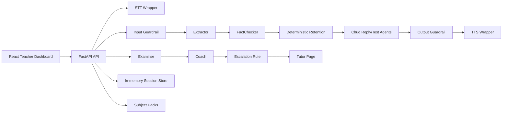

# Architecture

All LLM access is routed through `backend/app/llm.py::llm`. Agent prompts live in `backend/app/prompts/`. The retention engine is deterministic Python code and is the key knowledge-isolation boundary.

